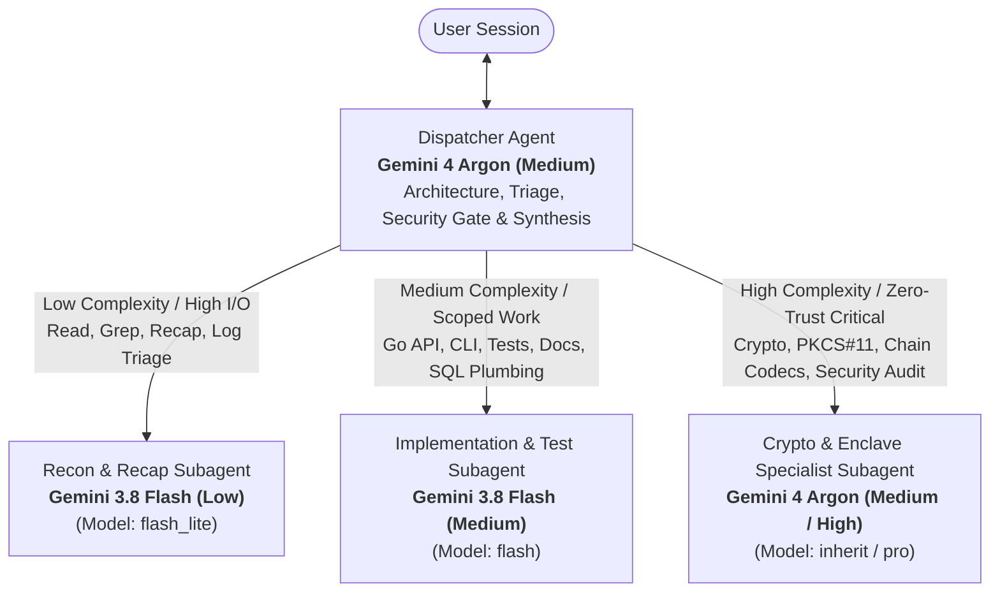

# AGENTS.md — Multi-Agent Architecture & Model Dispatch Specification

## 1. Overview: Hub-and-Spoke Dispatch Architecture

Polyglot combines high-assurance Rust cryptography, PKCS#11 HSM session management, multi-chain binary transaction codecs, a dual-port Go API queue, and role-isolated PostgreSQL schemas. Building and maintaining this stack efficiently requires matching **model capability** to **task complexity** while keeping the primary conversation context lean.

The agent hierarchy follows a strict **Dispatcher-Subagent (Hub-and-Spoke)** pattern:



---

## 2. The Dispatcher Agent (`Gemini 4 Argon Medium`)

The **Dispatcher Agent** is the primary agent active in the user's conversation session.

### Dispatcher Mandate
- **Never waste high-tier tokens on raw file dumps**: Do not read thousands of lines of test vectors (`vectors/*.json`), HTML (`docs/index.html`), or full test logs directly into the main session context when a `Gemini 3.8 Flash (Low)` subagent can grep, filter, and return a 20-line structured summary.
- **Evaluate before dispatching**: Every incoming user request is scored across three criteria:
  1. **Complexity**: Cognitive depth, cross-file invariants, and mathematical/cryptographic precision required.
  2. **Token Consumption**: Expected input context (number/size of files read, command output volume) and output length.
  3. **Task Required**: Reconnaissance/recap vs. standard engineering/testing vs. zero-trust cryptographic implementation.
- **Own the Security Boundary**: The Dispatcher formulates the plan, dispatches scoped work to subagents with explicit file boundaries and acceptance criteria, and validates that no subagent change weakens Polyglot's 9-step verification pipeline or database role isolation.

---

## 3. Model Selection & Dispatch Matrix

When invoking a subagent, select the model tier based on the task profile below:

| Model Tier | Tool `Model` Parameter | Subagent Type | Complexity | Token Footprint | Target Tasks in Polyglot |
|---|---|---|---|---|---|
| **Gemini 3.8 Flash (Low)** | `flash_lite` | `research` (read-only) | **Low** (Lookup, filter, summarize) | **High Input / Low Output** (absorbs file/log noise) | • Grepping symbols, error codes, or struct usages across `signer/` and `api/`<br/>• Reading and recapping specific sections of `Specs.md`, `README.md`, or `migrations/`<br/>• Inspecting test vector shapes in `vectors/*.json`<br/>• Comparing `secrets/pe/*.yaml` public keys against `deploy/signer.yaml`<br/>• Summarizing verbose `cargo test`, `go test`, or Docker Compose logs |
| **Gemini 3.8 Flash (Medium)** | `flash` | `research` or `self` | **Medium** (Scoped code, tests, docs, plumbing) | **Moderate Input / Moderate Output** | • Modifying Go HTTP handlers, middleware, or RFC 9457 responses in `api/internal/`<br/>• Updating `tools/pe-sim` CLI flags or demo script steps (`dev/demo.sh`)<br/>• Writing/running unit tests or SQL migration tests (`dev/test_migrations.sh`)<br/>• Updating documentation (`README.md`) or interactive diagrams in `docs/index.html`<br/>• Multi-file architectural tracing when cross-referencing Go API $\leftrightarrow$ Rust Signer DTOs |
| **Gemini 4 Argon (Medium / High)** | `inherit` (Argon Medium) or `pro` | `self` or `research` | **High** (Cryptographic, consensus, or security-critical) | **Focused Input / High-Precision Output** | • Modifying the 9-step [`EnvelopeProcessor`](signer/src/envelope/processor.rs) or JCS canonicalizer<br/>• PKCS#11 `CKM_AES_GCM` wrap/unwrap, `SessionKeyGuard`, or startup probe (`signer/src/pkcs11session/`, `signer/src/backend/`)<br/>• BIP32 (`secp256k1`) & SLIP10 (`ed25519`) derivation math (`signer/src/derive/`)<br/>• Blockchain codecs & sighash algorithms (`signer/src/chains/{bitcoin,evm,solana,tron,xrpl}.rs`)<br/>• PostgreSQL role isolation, advisory locks, and hash-chained audit triggers (`migrations/`)<br/>• Adversarial security reviews (`signer/tests/forging_api.rs`, `signer/tests/conformance.rs`) |

---

## 4. Decision Heuristics: Complexity, Token Consumption & Task Type

Use the following decision rules before spawning a subagent:

### Rule 1: Protect the Main Session Context Window (Token Consumption)
- **Trigger**: A task requires scanning $>3$ files, searching across the repo, inspecting `vectors/*.json`, reading `Specs.md` (36 KB) / `README.md` (42 KB) / `docs/index.html`, or parsing test/build output.
- **Action**: Dispatch a **Gemini 3.8 Flash (Low)** (`Model: "flash_lite"`) `research` subagent. Instruct it to return **only** file paths, line numbers, relevant snippets, and a concise bulleted recap.

### Rule 2: Match Code Generation Tier to Blast Radius (Complexity)
- **Trigger**: The task modifies code or tests.
- **Action**:
  - If the change is **outside** the cryptographic enclave (e.g., Go API routing/handlers in `api/`, `pe-sim` CLI ergonomics, Docker scripts in `dev/`, or documentation in `docs/`) and the contract is already clear $\rightarrow$ Dispatch **Gemini 3.8 Flash (Medium)** (`Model: "flash"`).
  - If the change touches **any** cryptographic invariant, binary transaction parser, sighash computation, PKCS#11 attribute template, `Zeroizing` buffer lifecycle, AEAD AAD construction, or SQL permission boundary $\rightarrow$ Handle in **Gemini 4 Argon (Medium)** (`Model: "inherit"`) or delegate to an isolated **Gemini 4 Argon** subagent for parallel execution/audit.

### Rule 3: Parallelize Independent Sub-Tasks (Latency & Context Isolation)
- When a task spans multiple chains or services (e.g., "audit error reason mappings across all 5 chain codecs and verify the Go API surfaces them in RFC 9457 format"):
  - Spawn a **Gemini 3.8 Flash (Low)** subagent to extract all `RejectReason` variants in `signer/` and `problem` mappings in `api/`.
  - Spawn a **Gemini 3.8 Flash (Medium)** or **Gemini 4 Argon** subagent per domain only after the recon summary is back.

---

## 5. Specialized Subagent Roles & Prompt Contracts

When calling `invoke_subagent`, use descriptive `Role` titles and enforce strict output contracts to minimize token round-trips.

### 5.1 Codebase Recon & Recap Agent
- **Model**: `Gemini 3.8 Flash (Low)` (`Model: "flash_lite"`, `TypeName: "research"`)
- **Role Examples**: `"Codebase Recon & Grep"`, `"Vector & Config Inspector"`, `"Log & Test Recap"`
- **When to Use**: Reading and grepping in files, locating symbol definitions, checking configuration parity, and recapping findings.
- **Prompt Template**:
  ```text
  Task: Locate and recap [specific topic/symbol/error] in Polyglot folder.
  Scope: Search only within [target directories, e.g., signer/src/ and api/internal/].
  Forbidden: Never inspect .auto-claude, .auto-claude-security.json, or .auto-claude-status. Do not print raw secrets from ./secrets/.
  Return Format (max 250 words):
  1. Exact file paths and line ranges (e.g., signer/src/envelope/processor.rs:L45-L90).
  2. Key findings / data flow recap in bullet points.
  3. Minimal code signatures or snippets (only the lines that matter).
  ```

### 5.2 API, Tooling & Test Runner Agent
- **Model**: `Gemini 3.8 Flash (Medium)` (`Model: "flash"`, `TypeName: "self"` or `"research"`)
- **Role Examples**: `"Go API & Queue Engineer"`, `"Test Suite Runner & Triager"`, `"PE-Sim & Docs Maintainer"`
- **When to Use**: Implementing well-scoped Go API features, updating `pe-sim`, running `make test` / `cargo test` / `go test`, authoring standard test cases, or updating docs.
- **Prompt Template**:
  ```text
  Task: [Specific implementation or test execution goal].
  Files in Scope: [Exact list of files to read/edit].
  Constraints:
  - Preserve all existing comments and docstrings.
  - Ensure `api_role` never touches `signer.*` tables and `/v1/wallets` never exposes `wrapped_seed`.
  - Run [specific test command, e.g., `cd api && go test ./...`] to verify.
  Return Format:
  1. Summary of changes made (files + line ranges).
  2. Test execution result (pass/fail count and any failure details).
  ```

### 5.3 Cryptographic & Enclave Specialist Agent
- **Model**: `Gemini 4 Argon` (`Model: "inherit"` or `"pro"`, `TypeName: "self"` or `"research"`)
- **Role Examples**: `"Rust Signer Crypto Architect"`, `"Chain Codec Specialist"`, `"Zero-Trust Security Auditor"`
- **When to Use**: Designing, implementing, or auditing changes in `signer/src/{backend,chains,derive,envelope,pkcs11session}/`, `migrations/`, or `signer/tests/{conformance,forging_api}.rs`.
- **Prompt Template**:
  ```text
  Task: [Cryptographic / codec / security task description].
  Security Invariants to Enforce:
  - 9-step fail-closed checklist order in `EnvelopeProcessor` must remain intact.
  - All seed and private key material must stay inside `zeroize::Zeroizing` buffers and ephemeral HSM session objects (`CKA_TOKEN=false`, `CKA_EXTRACTABLE=false`) guarded by `SessionKeyGuard`.
  - AEAD AAD (`{wallet_id}|{scheme}|{curve}|{seed_version}|{kek_label}`) must be built strictly from the verified request body, never DB metadata.
  - Cross-check with `cargo test --manifest-path signer/Cargo.toml` and `python3 dev/crosscheck_*.py`.
  Return Format:
  1. Root-cause / design analysis.
  2. Exact code changes and security invariants verified.
  3. Verification output from Rust unit/conformance and Python cross-check suites.
  ```

---

## 6. Concrete Dispatch Examples for Polyglot

| User Request | Dispatcher Assessment (`Gemini 4 Argon Medium`) | Subagent Dispatched | Why This Model Tier? |
|---|---|---|---|
| *"Find where `non_canonical_body` and `bad_signature` are returned and recap how the Go API translates them to HTTP status codes."* | **Low complexity**, read/grep across `signer/src/` and `api/internal/`, low reasoning needed. | **Gemini 3.8 Flash (Low)** (`flash_lite`, `research`) | Fast grep + read + recap keeps search noise out of the main session at minimal token cost. |
| *"Add a `--timeout` CLI flag to `pe-sim` and update `README.md` with an example."* | **Medium complexity**, isolated to `tools/pe-sim/` and `README.md`, zero enclave risk. | **Gemini 3.8 Flash (Medium)** (`flash`, `self`) | Straightforward Rust CLI + Markdown edit and `cargo test --manifest-path tools/pe-sim/Cargo.toml`. |
| *"Run the full test suite and tell me if anything fails."* | **Low/Medium complexity**, potentially large command output from Cargo/Go/Python. | **Gemini 3.8 Flash (Low)** (`flash_lite`) or **Flash (Medium)** (`flash`) | Subagent absorbs hundreds of lines of test runner stdout and returns a compact pass/fail summary. |
| *"Add support for a new ERC-20 `approve(address,uint256)` selector in the EVM chain codec and verify `TxSummary`."* | **High complexity**, modifies consensus/security-critical transaction parser in `signer/src/chains/evm.rs` and test vectors. | **Gemini 4 Argon** (`inherit`, `self`) + **Gemini 3.8 Flash (Low)** for initial vector lookup | Selector parsing, ABI decoding, and `blind_sign: false` guarantees are security-critical inside the Signer enclave. |
| *"Audit whether a compromised Go API can trick the Signer into unwrapping Wallet A's seed for a request targeting Wallet B."* | **High complexity**, security threat-model verification across `api`, `store.rs`, `processor.rs`, and `forging_api.rs`. | **Gemini 3.8 Flash (Low)** to gather code slices $\rightarrow$ **Gemini 4 Argon (Medium)** to verify AEAD AAD & test coverage | Combines cheap file retrieval with high-tier cryptographic reasoning. |

---

## 7. Non-Negotiable Guardrails for All Agents

1. **Workspace Exclusions**: Never access `.auto-claude/`, `.auto-claude-security.json`, or `.auto-claude-status`.
2. **No Blind Signing Regressions**: Any transaction codec change in `signer/src/chains/` must reject unrecognized transaction types, trailing bytes, or mismatched chain IDs with `unsupported_transaction` rather than falling back to digest signing.
3. **Zero Leftover HSM Objects**: Any PKCS#11 signing change must pass `cargo test --manifest-path signer/Cargo.toml --test conformance`, confirming `0` leftover session objects via `C_FindObjects` and `0` leaked secret bytes in the `TrackingAllocator` heap scan.
4. **Database Role Separation**: Never grant `api_role` permissions on `signer.*` or weaken the `BEFORE UPDATE OR DELETE` immutability triggers on `app.audit_log` and `signer.signer_audit`.
