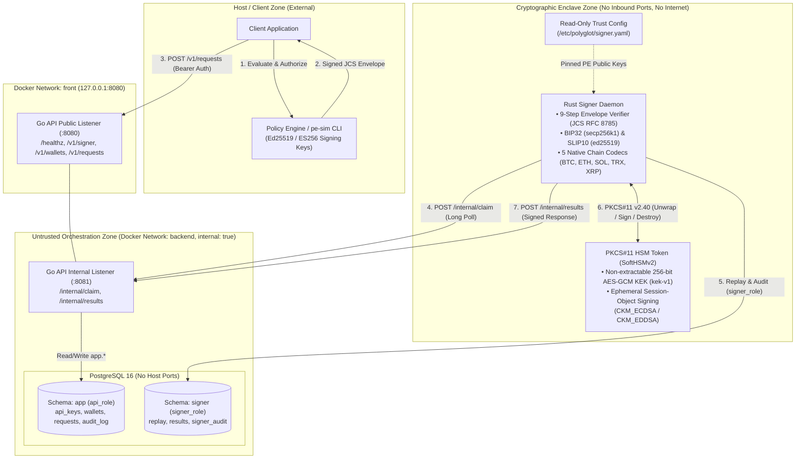
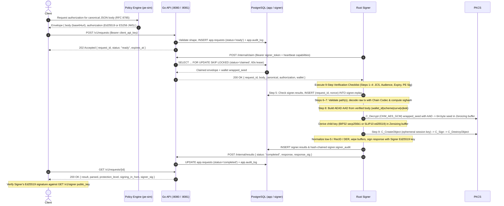
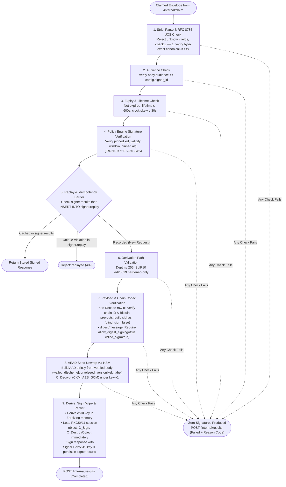
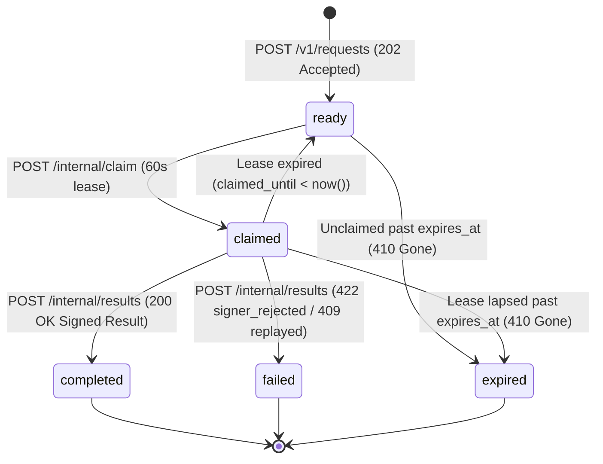
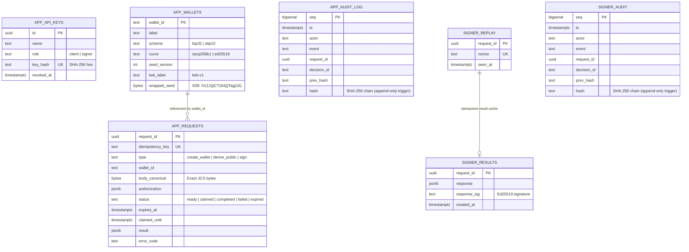

# Polyglot: Multi-Chain HD Wallet Signing Middleware (Generic Tier)

Polyglot is a vendor-neutral, multi-chain Hierarchical Deterministic (HD) wallet signing middleware designed for institutional custody and automated transaction workflows. It enforces a strict **zero-trust boundary** between API orchestration and cryptographic execution: the API gateway and PostgreSQL queue live in an untrusted zone, while key generation, seed unwrapping, derivation, transaction decoding, and signing occur strictly inside an isolated Rust Signer daemon backed by a PKCS#11 Hardware Security Module (SoftHSMv2 in the generic development tier).

Even a completely compromised API gateway or database cannot forge a signature, swap seeds across wallets, replay an old authorization, or extract a master seed.

For a visual walkthrough (architecture, the verification checklist under attack, per-chain key derivation, and every secret the stack needs), see the **[Polyglot explainer](https://aristocypros.github.io/Polyglot/)** (source: [`docs/index.html`](docs/index.html), served by GitHub Pages).

---

## Table of Contents

1. [System Architecture & Trust Zones](#1-system-architecture--trust-zones)
2. [End-to-End Request & Signing Sequence](#2-end-to-end-request--signing-sequence)
3. [Signer 9-Step Verification Checklist](#3-signer-9-step-verification-checklist)
4. [Security Model & Threat Matrix](#4-security-model--threat-matrix)
5. [Cryptographic Specification & AEAD Wrapping](#5-cryptographic-specification--aead-wrapping)
6. [Supported Blockchains & Transaction Codecs](#6-supported-blockchains--transaction-codecs)
7. [Quickstart Guide](#7-quickstart-guide)
8. [API Reference & Request Lifecycle](#8-api-reference--request-lifecycle)
9. [PostgreSQL Data Model & Role Isolation](#9-postgresql-data-model--role-isolation)
10. [Policy Engine Stand-In (`pe-sim`)](#10-policy-engine-stand-in-pe-sim)
11. [Testing & Vendor Conformance Suite](#11-testing--vendor-conformance-suite) · [Step-by-Step Manual Test](#step-by-step-manual-test)
12. [Repository Layout](#12-repository-layout)

---

## 1. System Architecture & Trust Zones

Polyglot runs three persistent services (`api`, `signer`, `postgres`) and one one-shot initialization job (`bootstrap`) across two isolated Docker networks (`front` and `backend`). The Signer opens **zero listening ports** and has **no route to the external internet** (`internal: true` on `backend`); it reaches out to the API's internal port (`:8081`) to claim queued envelopes.



---

## 2. End-to-End Request & Signing Sequence

Every operation (`create_wallet`, `derive_public`, `sign`) follows an asynchronous, policy-authorized flow where the API gateway acts strictly as an untrusted transport and work queue:



---

## 3. Signer 9-Step Verification Checklist

When the Signer claims a request from `/internal/claim`, [`EnvelopeProcessor`](signer/src/envelope/processor.rs) executes a strict 9-step fail-closed pipeline before any signature is produced:



---

## 4. Security Model & Threat Matrix

### Threat Controls

| Threat | Control Implemented | Residual Risk |
|---|---|---|
| **Compromised API or orchestrator** | Signer independently verifies the Policy Engine's cryptographic signature over the RFC 8785 canonical request body and never trusts API metadata. | API can delay or drop requests (DoS), but cannot forge a signature. |
| **Database stolen** | Master 64-byte seeds are AEAD-wrapped (`CKM_AES_GCM`) under a 256-bit non-extractable HSM KEK (`kek-v1`, `CKA_EXTRACTABLE=false`, `CKA_SENSITIVE=true`). | Attacker with both the database and HSM user PIN/token access could unwrap. |
| **Operator swaps `wrapped_seed` between wallets** | Canonical AEAD Associated Data (`wallet_id\|scheme\|curve\|seed_version\|kek_label`) is reconstructed by the Signer strictly from the signed request body, never from the DB row. | None — `C_Decrypt` fails closed with an authentication tag error. |
| **Replay of an old authorization** | Unique `request_id` (UUID) and 16-byte hex `nonce` recorded in `signer.replay` **before** execution; `api_role` has zero SQL permissions on the `signer` schema. | Requires keeping `signer_role` credentials isolated to the Signer. |
| **Compromised Policy Engine key** | Signer pins key IDs (`kid`), fixed algorithms, and `not_before`/`not_after` windows in read-only `/etc/polyglot/signer.yaml`. JWS headers with `alg: "none"`, mismatched `alg`, or unknown `crit` headers are rejected. | Whoever holds an active Policy Engine private key can authorize operations. |
| **Compromised Signer process** | Hardened container (`read_only: true`, `cap_drop: [ALL]`, `no-new-privileges`, `ulimit core 0`, internal-only network, `Zeroizing` buffers). | In the generic tier, the unwrapped seed exists briefly in Signer RAM during derivation; closed by native HSM derivation or TEEs in production tiers. |

### Honest Security Limits of the Generic Tier (`generic-dev`)

> [!WARNING]
> Every signed response explicitly reports `protection_level` (`generic-dev`, `generic-hsm`, or `native`), `backend` (`softhsm-generic`), `signing_in_hsm` (`true`/`false`), and `blind_sign` (`true`/`false`).

1. **SoftHSMv2 is Software**: In local Docker Compose (`generic-dev`), PKCS#11 is backed by SoftHSMv2 storing token objects in files protected by a PIN. It demonstrates the exact PKCS#11 flow, not physical tamper resistance.
2. **Seed in Signer Memory During Derivation**: Because standard PKCS#11 lacks portable cross-vendor BIP32/SLIP10 derivation with chain-code export restrictions, `C_Decrypt` returns the 64-byte seed into `Zeroizing<[u8; 64]>` in Signer RAM, derives the child key, loads the child key into the HSM as an ephemeral session object (`CKA_TOKEN=false`, `CKA_EXTRACTABLE=false`), signs, and immediately destroys the session object via RAII [`SessionKeyGuard`](signer/src/pkcs11session/sign.rs).
3. **Bitcoin Taproot BIP340 Schnorr Software Signing**: PKCS#11 has no standard mechanism for BIP340 Schnorr signatures or BIP86 TapTweak. Taproot key-path inputs are signed in software inside `Zeroizing` memory, and the response honestly reports `"signing_in_hsm": false`.
4. **Best-Effort Memory Hygiene**: All secret buffers use `zeroize::Zeroizing` and core dumps are disabled (`ulimit core 0`), verified by a heap-scanning [`TrackingAllocator`](signer/tests/conformance.rs) in the conformance suite.

---

## 5. Cryptographic Specification & AEAD Wrapping

### Derivation Schemes

| Scheme | Curve | Child Derivation | Max Depth | HSM Signing Mechanism | Output Public Key |
|---|---|---|---|---|---|
| **BIP32** | `secp256k1` | Hardened & non-hardened (`m/44'/...`, `m/86'/...`) | `255` | `CKM_ECDSA` (`CKK_EC`, OID `1.3.132.0.10`) | 33-byte compressed SEC1 |
| **SLIP10** | `ed25519` | Hardened only (`m/44'/501'/0'/0'`) | `255` | `CKM_EDDSA` (`CKK_EC_EDWARDS`, OID `1.3.101.112`) | 32-byte compressed Edwards |

### Seed Generation & AES-256-GCM Wrapping (`92 bytes`)

- **Master Seed**: 64 random bytes generated inside the HSM via `C_GenerateRandom` during `create_wallet`.
- **Wrapping Mechanism**: `CKM_AES_GCM` with a 256-bit non-extractable AES KEK (`kek-v1`) and a fresh 96-bit (12-byte) IV from `C_GenerateRandom` on every wrap.
- **Stored `wrapped_seed` Layout (`92 bytes`)**:
  ```text
  +--------------------+------------------------------------+--------------------+
  |   IV (12 bytes)    |     Ciphertext (64 bytes)          |  GCM Tag (16 bytes)|
  +--------------------+------------------------------------+--------------------+
  Bytes 0..12          Bytes 12..76                         Bytes 76..92
  ```
- **Canonical AEAD Associated Data (AAD)**:
  ```text
  "{wallet_id}|{scheme}|{curve}|{seed_version}|{kek_label}"
  # Example: "w_01HZ8F3A|bip32|secp256k1|1|kek-v1"
  ```

### Startup Capability Probe (Fail-Closed)

At boot, [`run_startup_probe`](signer/src/backend/generic/probe.rs) verifies:
1. PKCS#11 library loads and target slot/token is present.
2. `C_GetMechanismList` advertises `CKM_AES_GCM`, and a live wrap/unwrap/tamper self-test round-trips.
3. KEK (`kek-v1`) exists with `CKA_CLASS=CKO_SECRET_KEY`, `CKA_KEY_TYPE=CKK_AES`, `CKA_EXTRACTABLE=false`, `CKA_SENSITIVE=true`, `CKA_ENCRYPT=true`, `CKA_DECRYPT=true`, and no disallowed wrap/sign flags.
4. Built-in published BIP32 (Vectors 1–3) and SLIP10 (Vectors 1–2) self-tests pass in memory.
5. Ephemeral session-object signing self-test runs for `secp256k1` and `ed25519`, verifying signature validity and `0` leftover session objects (`C_FindObjects`). If a curve is unsupported by the HSM build, the probe marks that scheme as `signing: "software"` in `Capabilities`.

---

## 6. Supported Blockchains & Transaction Codecs

All five chain codecs live in [`signer/src/chains/`](signer/src/chains) and return a unified [`TxSummary`](signer/src/chains/mod.rs) (`transfers`, `fee`, `sequence`, and chain-specific `details`) so a single Policy Engine can inspect any chain's transaction.

| Chain | CAIP-2 Chain ID | Scheme & Curve | Accepted Transaction Types | Signing Input Computed by Signer | Signature Format Returned | `signing_in_hsm` |
|---|---|---|---|---|---|---|
| **Bitcoin** | `bitcoin:mainnet` / `bitcoin:testnet` | BIP32 `secp256k1`<br/>`input_paths` per input (`m/44'`, `m/49'`, `m/84'`, `m/86'`) | BIP174 PSBT with single-key inputs: **P2PKH**, **P2SH-P2WPKH**, **P2WPKH**, **P2TR (Taproot key-path)** | • Legacy sighash (P2PKH)<br/>• BIP143 sighash (SegWit v0)<br/>• BIP341 sighash (Taproot, BIP86 tweak) | Per input: `DER(low-S) \|\| sighash_byte` (ECDSA) or 64/65-byte **BIP340 Schnorr** (P2TR) | `true` for ECDSA-only PSBTs;<br/>`false` if any input is Taproot |
| **Ethereum & EVM** | `eip155:<chain_id>` (e.g. `eip155:1`) | BIP32 `secp256k1`<br/>`m/44'/60'/...` | EIP-1559 (Type `0x02`) and Legacy EIP-155 transfers & ERC-20 `transfer(address,uint256)` | `Keccak-256` of unsigned RLP payload (enforces tx `chain_id == chain`) | 65-byte `r (32B) \|\| s (32B, low-S) \|\| v (recid)` + `r`, `s`, `recovery_id` | `true` |
| **Solana** | `solana:mainnet` / `solana:devnet` | SLIP10 `ed25519`<br/>`m/44'/501'/...` | Legacy wire message containing only System Program `Transfer` (idx `2`) or `TransferWithSeed` (idx `11`) | Raw serialized message bytes | 64-byte Ed25519 signature | `true` |
| **Tron** | `tron:mainnet` | BIP32 `secp256k1`<br/>`m/44'/195'/...` | Protobuf `raw_data` with `TransferContract` (TRX) or `TriggerSmartContract` TRC-20 `transfer` | `SHA-256` of protobuf `raw_data` bytes | 65-byte `r (32B) \|\| s (32B, low-S) \|\| v (recid)` | `true` |
| **XRP Ledger** | `xrpl:mainnet` | BIP32 `secp256k1`<br/>`m/44'/144'/...` | Canonical XRPL binary `Payment` (`TransactionType = 0`, XRP drops or IOU) | `SHA-512Half` (first 32 bytes of SHA-512) over `STX\0` (`0x53545800`) + canonical signing fields | Canonical low-S DER ECDSA | `true` |

> [!IMPORTANT]
> **Bitcoin Prevout Verification**: For all non-Taproot inputs (`P2PKH`, `P2WPKH`, `P2SH-P2WPKH`), the PSBT **must** include the full previous transaction (`PSBT_IN_NON_WITNESS_UTXO`), which the Signer double-SHA256 hashes and matches against the input's prevout `txid` so input amounts and fees cannot be spoofed. Taproot inputs (`P2TR`) commit to all input amounts and `scriptPubKey`s inside the BIP341 sighash. Any multisig, P2WSH, or Taproot script-path input is rejected with `unsupported_transaction`.

---

## 7. Quickstart Guide

### Prerequisites
- **Docker** & **Docker Compose** (v2+)
- **GNU Make**, `curl`, `openssl`
- **Rust** (`cargo`) and **Go** (`1.24+`) for running local host unit tests and building `pe-sim`

### Step 1: Bootstrap Secrets, Policy Engine Keys & SoftHSM Token
Generates `./secrets/` (SoftHSM user and SO PINs, DB role passwords, client & signer bearer tokens, `pe-dev-1` Ed25519 and `pe-dev-2` ES256 keypairs), builds the container images, and runs the `bootstrap` container to initialize the SoftHSMv2 token (`polyglot-softhsm`), create the non-extractable `kek-v1` AES-256 key, and generate the Signer's Ed25519 identity key:
```bash
make bootstrap
```

The SoftHSM PINs are random by default. To choose them, set `SOFTHSM_USER_PIN` and `SOFTHSM_SO_PIN` (4 to 255 characters, no whitespace) before the first bootstrap:

```bash
SOFTHSM_USER_PIN='choose-a-user-pin' SOFTHSM_SO_PIN='choose-an-so-pin' make bootstrap
```

A PIN file that already exists is kept, because the token was initialized with it. Bootstrap stops with an error if a variable disagrees with the existing file. To change a PIN, delete its file under `secrets/` and reset the token with `docker compose -f deploy/compose.yaml down -v`, which deletes every wallet.

#### Secrets created by bootstrap

Every file is mode `0600` under the gitignored `secrets/` directory. Compose mounts each one at `/run/secrets/<name>`, so no secret is passed as an environment variable. Services log database URLs with the password replaced by `***`.

| File | Purpose | Used by |
|---|---|---|
| `softhsm_user_pin` | Logs in to the SoftHSM token (unwrap seeds, sign) | `bootstrap`, `signer` |
| `softhsm_so_pin` | Security Officer PIN, used to initialize the token | `bootstrap` |
| `db_admin_password` | `postgres` superuser: runs migrations and sets role passwords | `postgres`, `api` |
| `db_api_password` | `api_role`: read/write on `app.*` only | `api` |
| `db_signer_password` | `signer_role`: replay, results and signer audit tables | `signer` (also `api`, to set the role password) |
| `client_api_key` | Bearer token for `/v1/*` (role `client`) | host, `api` (stored as SHA-256) |
| `signer_token` | Bearer token for `/internal/*` (role `signer`) | `api` (stored as SHA-256), `signer` |
| `pe/pe-dev-1.key`, `pe/pe-dev-2.key` | Dev policy-engine private keys (Ed25519, ES256) for `pe-sim` | host only |

Two keys never exist under `secrets/`. `kek-v1` lives inside the HSM token, and the signer's Ed25519 identity key is written by `bootstrap` to the `hsm-tokens` volume. The policy engine's public keys are not secret; they are pinned in the read-only [`deploy/signer.yaml`](deploy/signer.yaml). The prototype uses no TLS certificates: all traffic stays on the internal Docker network, and requests and responses are protected by signatures.

### Step 2: Start the Hardened Stack
```bash
make up
```
Verify liveness and inspect the Signer's reported capabilities:
```bash
curl -s http://127.0.0.1:8080/healthz
# {"status":"ok"}

curl -s -H "Authorization: Bearer $(cat secrets/client_api_key)" http://127.0.0.1:8080/v1/signer | jq .
```

### Step 3: Run the End-to-End 5-Chain Demo
Runs [`./dev/demo.sh`](dev/demo.sh) (`pe-sim demo`) against the live Docker Compose stack:
```bash
make demo
```
What `make demo` executes and verifies:
1. Fetches `GET /v1/signer`, pins the Signer's Ed25519 identity public key, and asserts `protection_level == "generic-dev"` and `backend == "softhsm-generic"`.
2. Creates a **BIP32/secp256k1** wallet (authorized with `pe-dev-1` Ed25519) and a **SLIP10/ed25519** wallet (authorized with `pe-dev-2` ES256 detached JWS).
3. Derives public keys across all 5 chains (`m/44'/60'/0'/0/0`, `m/44'/501'/0'/0'`, `m/44'/195'/0'/0/0`, `m/44'/144'/0'/0/0`, `m/86'/0'/0'/0/0`).
4. Submits and signs a raw transfer transaction on **Ethereum (EIP-1559)**, **Solana (System Transfer)**, **Tron (TRX TransferContract)**, **XRP Ledger (Binary Payment)**, and **Bitcoin (PSBT with P2WPKH + Taproot P2TR inputs)**.
5. Verifies on every response:
   - The Signer's Ed25519 signature (`signer_sig`) over the canonical response payload.
   - The decoded `parsed` summary (`transfers`, `fee`, `sequence`) matches the submitted transaction.
   - The blockchain signature cryptographically verifies against the derived public key / recovered address.
   - Honest reporting of `signing_in_hsm: true` (EVM, Solana, Tron, XRPL) and `signing_in_hsm: false` (Bitcoin PSBT containing Taproot Schnorr).
6. Submits a **replayed request** (verified rejected with `409 Conflict` / `replayed`) and a **forged/tampered request** (verified rejected with `422 Unprocessable Entity` / `signer_rejected: bad_signature`).

### Step 4: Stop the Stack
```bash
make down
```

---

## 8. API Reference & Request Lifecycle

### Request State Machine



### Endpoints

| Listener | Method | Path | Required Role | Description |
|---|---|---|---|---|
| Public (`:8080`) | `GET` | `/healthz` | `none` | Liveness check (`200 OK` `{"status":"ok"}`) |
| Public (`:8080`) | `GET` | `/v1/signer` | `client` or `signer` (or public) | Signer ID, Ed25519 identity public key, `protection_level`, and `capabilities` |
| Public (`:8080`) | `POST` | `/v1/requests` | `client` | Submit a signed JCS envelope (optional `Idempotency-Key` header). Returns `202 Accepted`. |
| Public (`:8080`) | `GET` | `/v1/requests/{id}` | `client` | Poll status; returns signed response when `completed`, or RFC 9457 Problem Details on failure/expiry |
| Public (`:8080`) | `GET` | `/v1/wallets` | `client` | List wallet metadata (`wallet_id`, `label`, `scheme`, `curve`, `created_at` — never exposes `wrapped_seed`) |
| Public (`:8080`) | `GET` | `/v1/wallets/{id}` | `client` | Fetch single wallet metadata (`404 unknown_wallet` if missing) |
| Internal (`:8081`) | `POST` | `/internal/claim` | `signer` | 25s outbound long-poll (`FOR UPDATE SKIP LOCKED`) to claim next `ready` request and register heartbeat |
| Internal (`:8081`) | `POST` | `/internal/results` | `signer` | Persist signed result (and new wallet row for `create_wallet`) or structured failure reason |

### Example: `GET /v1/signer` (`200 OK`)

```json
{
  "signer_id": "signer-local-1",
  "public_key": "faad76af62a7f2f1c1e3dd51ba1e3ff20a4cae840f7d30c3770d7a95e9b1308c",
  "protection_level": "generic-dev",
  "capabilities": {
    "backend": "softhsm-generic",
    "protection_level": "generic-dev",
    "schemes": [
      { "scheme": "bip32", "curve": "secp256k1", "hardened_only": false, "signing": "hsm" },
      { "scheme": "slip10", "curve": "ed25519", "hardened_only": true, "signing": "hsm" }
    ],
    "max_depth": 255,
    "wrap_mechanism": "CKM_AES_GCM",
    "derives_in_hsm": false
  }
}
```

### Example: `POST /v1/requests` Request & `GET /v1/requests/{id}` Completed Response

**Submit Envelope (`POST /v1/requests`)**:
```json
{
  "body": "eyJhdWRpZW5jZSI6InNpZ25lci1sb2NhbC0xIiwiY2hhaW4iOiJlaXAxNTU6MSIsImN1cnZlIjoic2VjcDI1NmsxIiwiZGVjaXNpb25faWQiOiJkZWNfOGYzYiIsImV4cGlyZXNfYXQiOiIyMDI2LTEwLTE5VDIwOjAwOjAwWiIsIm5vbmNlIjoiMDEwMjAzMDQwNTA2MDcwODA5MGEwYjBjMGQwZTBmMTAiLCJwYXRoIjpbMjE0NzQ4MzY5MiwyMTQ3NDgzNzA4LDIxNDc0ODM2NDgsMCwwXSwicGF5bG9hZCI6IjAyZjgwMS4uLiIsInBheWxvYWRfZW5jb2RpbmciOiJ0eCIsInJlcXVlc3RfaWQiOiIzZmE4NWY2NC01NzE3LTQ1NjItYjNmYy0yYzk2M2Y2NmFmYTYiLCJzY2hlbWUiOiJiaXAzMiIsInR5cGUiOiJzaWduIiwidiI6MSwid2FsbGV0X2lkIjoid18wMUhaw4YzQSJ9",
  "authorization": {
    "kid": "pe-dev-1",
    "alg": "ed25519",
    "sig": "7W8x..."
  }
}
```

**Completed Response (`GET /v1/requests/{id}` -> `200 OK`)**:
```json
{
  "request_id": "3fa85f64-5717-4562-b3fc-2c963f66afa6",
  "decision_id": "dec_8f3b",
  "request_hash": "9c2e4b...",
  "status": "completed",
  "expires_at": "2026-10-19T20:00:00Z",
  "result": {
    "signature": "a1b2c3...",
    "r": "a1b2...",
    "s": "c3d4...",
    "recovery_id": 0,
    "public_key": "0279be66...",
    "signer_address": "0x742d35Cc6634C0532925a3b844Bc454e4438f44e"
  },
  "parsed": {
    "chain": "eip155:1",
    "transfers": [
      {
        "from": "0x742d35Cc6634C0532925a3b844Bc454e4438f44e",
        "to": "0xd8dA6BF26964aF9D7eEd9e03E53415D37aA96045",
        "amount": "1000000000000000000",
        "asset": "ETH"
      }
    ],
    "fee": { "amount": "42000000000000", "asset": "ETH" },
    "sequence": "42",
    "details": { "tx_type": "eip1559", "chain_id": 1 }
  },
  "protection_level": "generic-dev",
  "backend": "softhsm-generic",
  "signing_in_hsm": true,
  "blind_sign": false,
  "signed_at": "2026-10-19T19:01:02Z",
  "signer_sig": "e4d18f..."
}
```

### RFC 9457 Problem Details Errors (`application/problem+json`)

All API and Signer rejections return RFC 9457 Problem Details with a stable `code` (`invalid_request`, `unauthorized`, `unknown_wallet`, `request_expired`, `replayed`, `signer_rejected`, `signer_unavailable`) and, when rejected by the Signer, a specific `reason` (`bad_signature`, `unknown_kid`, `key_expired`, `alg_mismatch`, `audience_mismatch`, `non_canonical_body`, `unsupported_transaction`, `digest_signing_disabled`, etc.):

```json
{
  "type": "https://polyglot.local/problems/signer_rejected",
  "title": "Signer Rejected Request",
  "status": 422,
  "detail": "request rejected by signer (reason: bad_signature)",
  "code": "signer_rejected",
  "reason": "bad_signature"
}
```

---

## 9. PostgreSQL Data Model & Role Isolation

PostgreSQL 16 is partitioned into two schemas (`app` and `signer`) with strict role separation enforced by SQL migrations ([`migrations/000001_initial_schema.up.sql`](migrations/000001_initial_schema.up.sql)):



- **`api_role`**: Granted access strictly to `app.*`. Explicitly denied all privileges on `signer.*` (`REVOKE ALL ON SCHEMA signer FROM api_role`), preventing a compromised API from deleting replay entries or injecting fake results.
- **`signer_role`**: Granted `SELECT, INSERT` on `signer.replay`, `signer.results`, and `signer.signer_audit` (plus read-only `SELECT` on `app.wallets`).
- **Immutable Hash-Chained Audit Logs**: Both `app.audit_log` and `signer.signer_audit` chain every row with `SHA256(prev_hash || seq || ts || actor || event || request_id || decision_id)` under an advisory lock and enforce `BEFORE UPDATE OR DELETE` database triggers that block any mutation even by privileged roles.

---

## 10. Policy Engine Stand-In (`pe-sim`)

[`tools/pe-sim`](tools/pe-sim) is a standalone host CLI tool that acts as the client's Policy Engine during local development and testing.

```bash
# 1. Generate an Ed25519 or ES256 Policy Engine keypair and signer.yaml snippet
./tools/pe-sim/pe-sim keygen --alg ed25519 --kid pe-dev-1 --out ./secrets/pe
./tools/pe-sim/pe-sim keygen --alg es256   --kid pe-dev-2 --out ./secrets/pe

# 2. Canonicalize a JSON request body (RFC 8785) and sign it into a ready-to-submit envelope
./tools/pe-sim/pe-sim sign \
  --key ./secrets/pe/pe-dev-1.key \
  --kid pe-dev-1 \
  --alg ed25519 \
  --in request_body.json \
  --label "Treasury Vault"
```

---

## 11. Testing & Vendor Conformance Suite

Run the full unit, vector, cross-language, and conformance suite via `Makefile`:

```bash
# Run all Rust unit/integration/conformance tests, Go API tests, and Python JCS & BIP32/SLIP10 cross-checks
make test

# Run live end-to-end 5-chain demo against Docker Compose
make e2e
```

### Individual Test Commands

| Suite | Command | What It Verifies |
|---|---|---|
| **Rust Signer Suite (196 tests)** | `cargo test --manifest-path signer/Cargo.toml` | BIP32/SLIP10 vectors, PKCS#11 session & AEAD wrap/unwrap, all 5 chain codecs (including BIP143, BIP341 & 4-input PSBT), JCS canonicalization, Ed25519/ES256 auth, Forging-API harness (`tests/forging_api.rs`), and queue resilience. |
| **Go API Suite** | `cd api && go test -v ./...` | Dual-port server, SHA-256 Bearer auth role guards, RFC 9457 errors, Postgres migrations, `FOR UPDATE SKIP LOCKED` concurrency, lease recovery, and hash-chained `app.audit_log`. |
| **Python Derivation Cross-Check** | `python3 dev/crosscheck_derive.py` | Compares 2,000 random paths (1,000 BIP32 `secp256k1` + 1,000 SLIP10 `ed25519`) against Python `bip_utils` with 0 mismatches. |
| **Python JCS Cross-Check** | `python3 dev/crosscheck_jcs.py` | Verifies byte-for-byte RFC 8785 canonicalization agreement between Python and Rust across shared vectors and 500 fuzz cases. |
| **DB Role Isolation Matrix** | `./dev/test_migrations.sh` | Executes a 28-point SQL permission matrix against PostgreSQL 16 confirming `api_role` and `signer_role` isolation and audit log immutability. |
| **Vendor Conformance Suite** | `cargo test --manifest-path signer/Cargo.toml --test conformance` | Certifies any PKCS#11 backend against `dyn Backend` + heap-scanning `TrackingAllocator` zeroization checks. |

### Step-by-Step Manual Test

This walkthrough checks the stack one layer at a time, from a clean checkout to a signed wallet, a rejected replay and a rejected forgery. Run every command from the repository root. You need `jq` and `uuidgen` besides the Quickstart prerequisites.

**Step 1: Run the offline test suites.** Nothing needs to be running yet.

```bash
make test
```

Expected: every Rust, Go and Python suite passes, including 0 mismatches in both cross-checks.

**Step 2: Bootstrap secrets and the HSM token.**

```bash
make bootstrap
ls -l secrets secrets/pe
```

Expected: `secrets/` holds `softhsm_user_pin`, `softhsm_so_pin`, `db_admin_password`, `db_api_password`, `db_signer_password`, `client_api_key` and `signer_token`, each with mode `-rw-------`, plus `pe-dev-1.*` and `pe-dev-2.*` in `secrets/pe/`. Running it again keeps existing secrets (`[.] ... already exists`).

**Step 3: Check the pinned policy-engine keys.** The `public_key` printed for each kid must match the entry in [`deploy/signer.yaml`](deploy/signer.yaml), otherwise every request fails with `bad_signature`.

```bash
cat secrets/pe/pe-dev-1.yaml secrets/pe/pe-dev-2.yaml
grep -A2 'kid: "pe-dev-' deploy/signer.yaml
```

If you regenerated the keys, paste the new snippets into `deploy/signer.yaml` and restart the signer.

**Step 4: Start the stack and check its shape.**

```bash
make up
docker compose -f deploy/compose.yaml ps -a
```

Expected: `bootstrap` exited with code 0; `postgres`, `api` and `signer` are running. Only `api` publishes a port (`127.0.0.1:8080`). The signer and Postgres publish none.

**Step 5: Check liveness and the signer's identity.**

```bash
curl -s http://127.0.0.1:8080/healthz
curl -s -H "Authorization: Bearer $(cat secrets/client_api_key)" http://127.0.0.1:8080/v1/signer | jq '{signer_id, protection_level, backend: .capabilities.backend, schemes: .capabilities.schemes}'
```

Expected: `{"status":"ok"}`, then `signer_id: "signer-local-1"`, `protection_level: "generic-dev"` and `backend: "softhsm-generic"`. If `/v1/signer` reports the signer unavailable, read `docker compose -f deploy/compose.yaml logs signer`: the startup probe states why it refused to start. If the signer stays in `Created` and `logs bootstrap` shows `No space left on device`, Docker's disk is full. Run `docker builder prune -f` to clear the build cache, then `make up` again.

**Step 6: Check that a missing API key is refused.**

```bash
curl -s -o /dev/null -w '%{http_code}\n' http://127.0.0.1:8080/v1/wallets
```

Expected: `401`.

**Step 7: Create a wallet by hand.** Build a request body, have `pe-sim` sign it as the policy engine, and submit it.

```bash
export KEY="$(cat secrets/client_api_key)"
export EXP="$(python3 -c 'import datetime as d;print((d.datetime.now(d.timezone.utc)+d.timedelta(minutes=5)).strftime("%Y-%m-%dT%H:%M:%SZ"))')"
export WALLET="w_manual_$(date +%s)"
```

```bash
jq -n --arg rid "$(uuidgen | tr A-Z a-z)" --arg nonce "$(openssl rand -hex 16)" --arg exp "$EXP" --arg w "$WALLET" \
  '{v:1, type:"create_wallet", request_id:$rid, nonce:$nonce, audience:"signer-local-1", expires_at:$exp, decision_id:"dec-manual-1", wallet_id:$w, scheme:"bip32", curve:"secp256k1"}' > /tmp/create.json
```

```bash
./tools/pe-sim/pe-sim sign --key secrets/pe/pe-dev-1.key --kid pe-dev-1 --alg ed25519 --in /tmp/create.json --label "Manual test" --out /tmp/create.env.json
```

```bash
curl -s -X POST -H "Authorization: Bearer $KEY" -H "Content-Type: application/json" --data @/tmp/create.env.json http://127.0.0.1:8080/v1/requests | tee /tmp/create.resp.json | jq .
```

Expected: `202` with `status: "ready"`.

**Step 8: Poll for the signed result.**

```bash
curl -s -H "Authorization: Bearer $KEY" http://127.0.0.1:8080/v1/requests/$(jq -r .request_id /tmp/create.resp.json) | jq '{status, protection_level, signing_in_hsm, signer_sig}'
```

Expected within a few seconds: `status: "completed"`, `protection_level: "generic-dev"` and a `signer_sig`. Then confirm the wallet exists and that its seed is never exposed:

```bash
curl -s -H "Authorization: Bearer $KEY" http://127.0.0.1:8080/v1/wallets/$WALLET | jq .
```

Expected: `wallet_id`, `label`, `scheme`, `curve`, `created_at`, and no `wrapped_seed`.

**Step 9: Derive an Ethereum public key** at `m/44'/60'/0'/0/0` (hardened indices add `0x80000000`).

```bash
jq -n --arg rid "$(uuidgen | tr A-Z a-z)" --arg nonce "$(openssl rand -hex 16)" --arg exp "$EXP" --arg w "$WALLET" \
  '{v:1, type:"derive_public", request_id:$rid, nonce:$nonce, audience:"signer-local-1", expires_at:$exp, decision_id:"dec-manual-2", wallet_id:$w, scheme:"bip32", curve:"secp256k1", path:[2147483692,2147483708,2147483648,0,0]}' > /tmp/derive.json
./tools/pe-sim/pe-sim sign --key secrets/pe/pe-dev-1.key --kid pe-dev-1 --alg ed25519 --in /tmp/derive.json --out /tmp/derive.env.json
RID=$(curl -s -X POST -H "Authorization: Bearer $KEY" -H "Content-Type: application/json" --data @/tmp/derive.env.json http://127.0.0.1:8080/v1/requests | jq -r .request_id)
sleep 3
curl -s -H "Authorization: Bearer $KEY" http://127.0.0.1:8080/v1/requests/$RID | jq '{status, public_key: .result.public_key}'
```

Expected: `completed` and a 33-byte compressed key (66 hex characters starting with `02` or `03`).

**Step 10: Replay an approved request.**

```bash
curl -s -X POST -H "Authorization: Bearer $KEY" -H "Content-Type: application/json" --data @/tmp/create.env.json http://127.0.0.1:8080/v1/requests | jq '{status, code}'
```

Expected: `409` with `code: "replayed"`.

**Step 11: Forge a request.** Take a valid authorization and attach it to a different body, as a compromised API would.

```bash
jq --arg w "${WALLET}_forged" --arg rid "$(uuidgen | tr A-Z a-z)" '.wallet_id=$w | .request_id=$rid' /tmp/create.json > /tmp/forged.json
jq -n --slurpfile env /tmp/create.env.json --arg body "$(./tools/pe-sim/pe-sim sign --key secrets/pe/pe-dev-1.key --kid pe-dev-1 --alg ed25519 --in /tmp/forged.json | jq -r .body)" \
  '{body:$body, authorization:$env[0].authorization}' > /tmp/forged.env.json
RID=$(curl -s -X POST -H "Authorization: Bearer $KEY" -H "Content-Type: application/json" --data @/tmp/forged.env.json http://127.0.0.1:8080/v1/requests | jq -r .request_id)
sleep 3
curl -s -H "Authorization: Bearer $KEY" http://127.0.0.1:8080/v1/requests/$RID | jq '{status, code, reason}'
```

Expected: `422` with `code: "signer_rejected"` and `reason: "bad_signature"`. The API accepted the envelope because it only checks shape; the signer refused it.

**Step 12: Run the full five-chain demo and the database isolation matrix.**

```bash
make demo
./dev/test_migrations.sh
```

Expected: the demo exits with code 0 after signing on all five chains; the migration script reports all 28 permission checks passing.

**Step 13: Stop the stack.**

```bash
make down
```

`make down` keeps the `pgdata` and `hsm-tokens` volumes, so wallets survive a restart. To start over completely, run `docker compose -f deploy/compose.yaml down -v`. This deletes every wallet and the HSM token, including `kek-v1`, so any wrapped seed left elsewhere can never be decrypted again.

### Pointing the Conformance Suite at an External HSM Simulator (e.g., Utimaco, CloudHSM, YubiHSM2)

The generic backend requires only four configuration values to switch from SoftHSMv2 to a hardware PKCS#11 vendor module:

```bash
export CONFORMANCE_PKCS11_MODULE="/opt/utimaco/lib/libcs_pkcs11_R3.so"
export CONFORMANCE_PKCS11_SLOT="0"
export CONFORMANCE_PKCS11_PIN_FILE="/path/to/user.pin"
export CONFORMANCE_KEK_LABEL="kek-v1"

cargo test --manifest-path signer/Cargo.toml --test conformance -- --nocapture
```

---

## 12. Repository Layout

```text
.
├── api/                        # Go HTTP API gateway, Postgres queue & audit chain
│   ├── cmd/api/                # Dual-port server entrypoint (:8080 public, :8081 internal)
│   └── internal/               # auth, db (migrations + audit), handlers, problem (RFC 9457), server
├── signer/                     # Rust Signer daemon & cryptographic library
│   ├── src/
│   │   ├── backend/            # Backend trait, domain types & generic PKCS#11 implementation + probe
│   │   ├── chains/             # 5 chain codecs: bitcoin (PSBT/Taproot), evm, solana, tron, xrpl
│   │   ├── derive/             # Pure-Rust BIP32 (secp256k1) & SLIP10 (ed25519) derivation
│   │   ├── envelope/           # RFC 8785 JCS canonicalizer, Ed25519/ES256 verifier & 9-step processor
│   │   ├── pkcs11session/      # Cryptoki wrapper, CKM_AES_GCM wrap/unwrap & SessionKeyGuard
│   │   ├── bootstrap.rs        # One-shot HSM token & KEK initializer
│   │   ├── store.rs            # Signer-owned Postgres replay, results & audit store
│   │   └── worker.rs           # Outbound long-polling worker (/internal/claim -> /internal/results)
│   └── tests/                  # conformance, derive_vectors, envelope_jcs, forging_api, hsm_integration, queue_resilience
├── tools/pe-sim/               # Host CLI Policy Engine stand-in (keygen, sign, 5-chain e2e demo)
├── vectors/                    # Published & shared test vectors (bip32, slip10, jcs, tx_*)
├── migrations/                 # SQL migrations (app & signer schemas, roles, immutable audit triggers)
├── deploy/                     # Hardened Docker Compose (compose.yaml) & read-only signer.yaml
├── dev/                        # Bootstrap, demo, migration tests & Python cross-check scripts
└── docs/                       # GitHub Pages site: index.html explainer page
```

